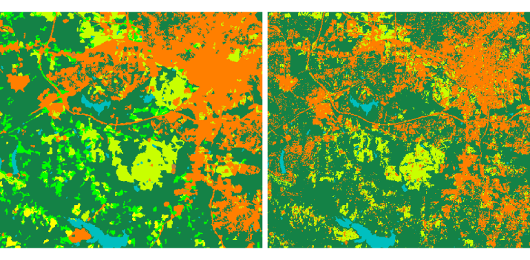

## DESCRIPTION

*r.learn.assembly* combines several machine learning algorithms from the
scikit-learn package into a single ensemble model and trains it on the predictor
rasters of an imagery group, using labelled pixels or training points as the
response. It is a companion to *r.learn.train*, which trains one estimator at a
time. The fitted ensemble model can be used in *r.learn.predict* like a model
from *r.learn.train*. For more information about the models and their
hyper-parameters, see the manual page of *[r.learn.train](r.learn.train.md)*.

Two ensemble strategies are supported through the **ensemble_type** option:

- **voting** combines predictions from multiple base models using fixed weights
  (equal by default, or specified by the user). For classification,
  voting='soft' averages the predicted class probabilities, while voting='hard'
  selects the class receiving the most (weighted) votes. For regression, a
  (weighted) average of the model predictions is used.
- **stacking** combines predictions from the base models into a single
  prediction. A second-level model (meta-learner) is trained on their
  cross-validated predictions to learn how best to combine them. This approach
  aims to exploit the strengths of different models and improve overall
  predictive performance. For more information, see
  [Stacked generalization](https://scikit-learn.org/stable/modules/ensemble.html#stacking).
  The meta-model coefficients reported after training are the fitted
  coefficients of the meta-learner, not normalized per-model weights: a base
  model can contribute several inputs and the coefficients can be negative, so
  they are not directly comparable to the fixed voting weights.

Both strategies work for classification and for regression, as long as every
base model in the configuration is of the same kind (all classifiers or all
regressors). Note that soft voting requires classifiers that support probability
predictions (predict_proba), ideally with well-calibrated probabilities.

### Two-step workflow

The base models and their parameters are supplied in a JSON configuration file,
while the shared settings (ensemble type, weighting, cross-validation,
preprocessing) are module options. A typical run therefore has two steps.

1. **Write a configuration template.** The module writes a JSON file, filled
   with each estimator's scikit-learn default values, and exits. It holds two
   kinds of entry, kept separate:

   - The **base models**, selected with the **models** option: one entry per
     model. Note that it is also possible to select the same algorithm (e.g.,
     Random Forest) more than once, using different parameter settings;
   - The stacking **meta-model**, a single `final_estimator` entry selected with
     the **final_estimator** option. It is written only for a stacking template
     (the default **ensemble_type**) and defaults to LogisticRegression for
     classification and RidgeCV for regression.

   Give the output path with **write_config**:

   ```sh
   r.learn.assembly models=RandomForestClassifier,SVC,KNeighborsClassifier \
       write_config=ensemble.json
   ```

2. **Edit and run**, adjust the parameters and (for voting) the weights in
   `ensemble.json`, then pass it back with the **config** option together with
   the training data and the shared settings:

   ```sh
   r.learn.assembly config=ensemble.json group=predictors \
       training_points=training_pts field=class ensemble_type=stacking \
       cv=5 inner_cv=5 save_model=ensemble.gz
   ```

The configuration file (see below) is what drives the ensemble and gives it its
flexibility. A benefit of the two-step approach is that the template already
lists each estimator’s parameters, so you do not have to remember or look up
which ones belong to the selected model.

### Configuration file format

The configuration is a JSON object with one entry per base model. Each key is
a free label used to identify the model in the ensemble and in the report;
each value gives the estimator name, an optional voting **weight**, and the
estimator parameters. The reserved key **final_estimator** describes the
stacking meta-model rather than a base model: it takes an `estimator` and its
`params` (no `weight`). For example:

```json
{
  "rf":  {"estimator": "RandomForestClassifier", "weight": 2.0,
          "params": {"n_estimators": 500, "max_features": "sqrt"}},
  "svc": {"estimator": "SVC", "weight": 1.0,
          "params": {"C": 10.0, "kernel": "rbf"}},
  "knn": {"estimator": "KNeighborsClassifier", "weight": 1.0,
          "params": {"n_neighbors": 7}},
  "final_estimator": {"estimator": "LogisticRegression",
          "params": {"C": 0.1, "max_iter": 500}}
}
```

Parameters that are not listed keep the estimator's default, while parameters
that are not valid for an estimator are ignored with a warning. The `weight`
field is used only for voting ensembles and ignored for stacking. The
**final_estimator** entry is used only for stacking and ignored for voting; when
it is absent, the meta-model falls back to the **final_estimator** module
option.

The meta-model must be of the same kind (classifier or regressor) as the base
models. The available meta-models are LogisticRegression, LogisticRegressionCV
and RandomForestClassifier for classification, and RidgeCV, LinearRegression and
RandomForestRegressor for regression. Note that RidgeCV and LogisticRegressionCV
tune their own regularization internally. The seed (**random_state**) and the
number of cores (**nprocs**) are taken from the module options and should not be
set in the file.

### Cross-validation

Two independent cross-validation settings are offered:

- **cv** is the *outer* cross-validation that reports the performance of the
  whole ensemble. With **cv** greater than 1, the module prints global accuracy
  measures, a per-class report (classification), and the cross-validated score
  of each base model on its own, so the ensemble can be compared with its
  members. The per-class report and the cross-validation predictions can be
  written to CSV with **classif_file** and **preds_file**.
- **inner_cv** is used only by stacking, as the internal cross-validation that
  produces the out-of-fold base-model predictions on which the meta-model is
  trained. It has no effect for the voting.

When a **group_raster** is provided by the user, samples sharing a group id are
kept together in the same cross-validation fold. This allows for spatial
cross-validation, which provides a more robust estimate of the predictive
performance of the (ensemble) model. Note that grouping is applied only to the
**outer** cross-validation (**cv**). The internal stacking cross-validation
(**inner_cv**) does not currently keep groups together, so the meta-model is
trained on out-of-fold predictions that may share spatial groups across folds.

## NOTES

Base-model hyperparameters are taken from the configuration file. There is
currently no option to tune them using grid search. For further tuning, one can
use a similar approach as used by stacking libraries such as *SuperLearner* and
*stacks*. Supply different models (estimators), including the same estimator
repeated with different fixed hyperparameters, and let the ensemble combine
them. For stacking, the meta-model learns how much to rely on each member, while
for voting, the weights do. This avoids the optimistic bias that arises when
base models are tuned on the same samples later used to fit and evaluate the
ensemble.

The configuration makes this easy: the same estimator can appear several times
under different keys, each independently editable. On the command line, list it
more than once in the **models** option, and the template writes a separate entry
for each, suffixing repeats to keep the keys unique (for example
`GradientBoostingClassifier` and `GradientBoostingClassifier_2`). In the GUI an
estimator can be selected only once, so add further copies by duplicating its
entry in the JSON under a new key. Either way, a library of varied
configurations lives in a single file:

```sh
r.learn.assembly \
    models=GradientBoostingClassifier,GradientBoostingClassifier,RandomForestClassifier \
    write_config=ensemble.json
```

For tuning the meta-model itself, select one of the self-tuning options, RidgeCV
(the regression default) and LogisticRegressionCV. They select their own
regularization strength internally by cross-validation. Their candidate grid and
number of folds are set through the `final_estimator` params, for example `Cs`
and `cv` for LogisticRegressionCV, or `alphas` for RidgeCV. To explore how a
single estimator behaves on its own, *r.learn.train* can still be used, but
selecting its hyperparameters on the full dataset and then reusing those samples
in the ensemble biases the reported performance, so a fixed library is preferred
here.

*r.learn.predict* can output class probabilities, which requires the model to
provide `predict_proba`. Hard voting does not, so use soft voting or stacking
if probability output is needed.

The **-b** flag balances imbalanced classes by weighting samples inversely to
their class frequencies (classification only). The weights are passed to every
base model during fitting, so it can only be used when all base models support
sample weights. The module checks this and reports any that do not. Estimators
such as *KNeighborsClassifier*, *LinearDiscriminantAnalysis*,
*QuadraticDiscriminantAnalysis* and *MLPClassifier* do not support sample
weights.

The **-f** flag computes permutation feature importances of the fitted
ensemble, saved to **fimp_file** and usable by *r.learn.report*. As in
*r.learn.train*, importances are computed on the training data (not an
independent validation set) using the tuning score (Matthews correlation
coefficient for classification, R-squared for regression), so they describe how
the model uses each predictor rather than how it generalizes.

## EXAMPLES

We are using the same example as in *[r.learn.train](r.learn.train.md)*, using
the GRASS GIS sample North Carolina data set as a basis to perform a landsat
classification. We are going to classify a Landsat 7 scene from 2000, using
training information from an older (1996) land cover dataset.

Note that this example must be run in the "landsat" mapset of the North Carolina
sample data set location.

First, we are going to generate some training pixels from an older (1996) land
cover classification.

```sh
g.region raster=landclass96 -p
r.random -s input=landclass96 npoints=5000 raster=training_pixels
```

Then we can use these training points to perform a classification on the more
recently obtained landsat 7 image. By default, this will use the stacking
ensembly method.

```sh
# 1. write a template for the chosen base models
r.learn.assembly models=RandomForestClassifier,SVC,KNeighborsClassifier \
    write_config=ensemble.json 

# 2. (edit ensemble.json), then train with 5-fold outer cross-validation
r.learn.assembly config=ensemble.json group=lsat7_2000 \
    training_map=training_pixels ensemble_type=stacking \
    cv=5 inner_cv=5 classif_file=report.csv save_model=ensemble.gz

# 3. apply the fitted ensemble to the rasters
r.learn.predict group=lsat7_2000 load_model=ensemble.gz output=classification
r.colors map=classification raster=landclass96
```

The original map (left) and the prediction map (right) are shown below:



The same configuration can be reused for a voting ensemble; only the options
change. The base models and their weights in `ensemble.json` are shared, and the
`final_estimator` entry is ignored for voting. Here we reuse it for soft voting,
standardizing the predictors first with the **-s** flag (edit the `weight`
fields in `ensemble.json` to give some models more say in the vote):

```sh
# reuse ensemble.json, now as a soft-voting ensemble
r.learn.assembly config=ensemble.json group=lsat7_2000 \
    training_map=training_pixels ensemble_type=voting voting=soft \
    cv=5 save_model=ensemble_voting.gz -s

r.learn.predict group=lsat7_2000 load_model=ensemble_voting.gz \
    output=classification_voting
r.colors map=classification_voting raster=landclass96
```

## REFERENCES

Buitinck, L., Louppe, G., Blondel, M., Pedregosa, F., Mueller, A., Grisel, O.,
Niculae, V., Prettenhofer, P., Gramfort, A., Grobler, J., Layton, R.,
VanderPlas, J., Joly, A., Holt, B., & Varoquaux, G. (2013). API design for
machine learning software: Experiences from the scikit-learn project. ECML PKDD
Workshop: Languages for Data Mining and Machine Learning, 108–122.

Pedregosa, F., Varoquaux, G., Gramfort, A., Michel, V., Thirion, B., Grisel, O.,
Blondel, M., Prettenhofer, P., Weiss, R., Dubourg, V., Vanderplas, J., Passos,
A., Cournapeau, D., Brucher, M., Perrot, M., & Duchesnay, É. (2011).
Scikit-learn: Machine Learning in Python. Journal of Machine Learning Research,
12(Oct), 2825–2830.

## SEE ALSO

*[r.learn.ml2](r.learn.ml2.md)*,
*[r.learn.predict](r.learn.predict.md)*,
*[r.learn.train](r.learn.train.md)*

scikit-learn documentation on
[ensemble methods](https://scikit-learn.org/stable/modules/ensemble.html).

## AUTHORS

[Paulo van Breugel](https://ecodiv.earth), [HAS green
academy](https://has.nl), [Innovative Biomonitoring research
group](https://www.has.nl/en/research/professorships/innovative-bio-monitoring-professorship/),
[Climate-robust Landscapes research
group](https://www.has.nl/en/research/professorships/climate-robust-landscapes-professorship/)

Built on the *r.learn.ml2* toolset by Steven Pawley.
