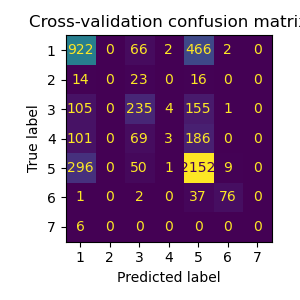
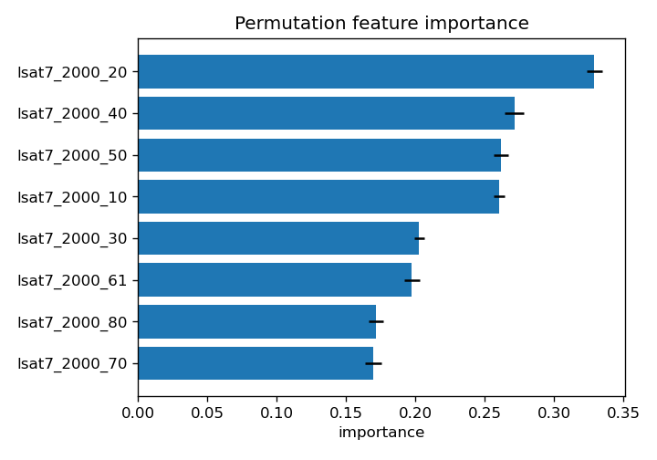
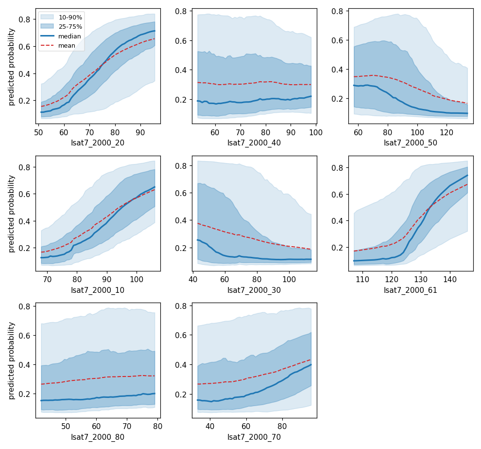
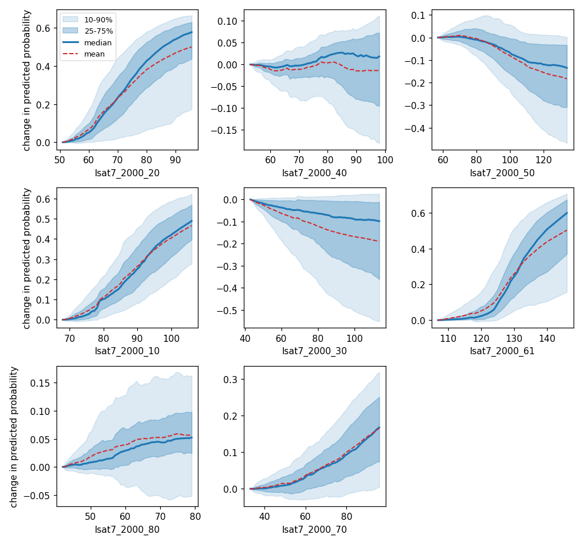

## DESCRIPTION

*r.learn.report* creates a report using the outputs of *r.learn.train* and
*r.learn.assembly*. It takes a fitted model and the optional cross-validation,
feature-importance and hyperparameter CSV files that those tools can write, and
produces a document with short explanations, summary tables and figures.

The report is written as Markdown. Figures are saved as PNG files in a
directory next to the report, named after it (for `report.md` the directory is
`report_plots`), and referenced from the document with relative paths, so the
report and its figure directory should be kept together.

Every input is optional; the report contains a section for each input that is
supplied, so the module can be used to create a quick model summary and a more
full report:

- **load_model** adds a *Model* section describing the estimator, its
  predictors, and, for an ensemble from *r.learn.assembly*, the base models
  with their voting weights or the learned stacking coefficients.
- **preds_file** (cross-validation predictions) adds a *Cross-validation
  performance* section with per-fold score summaries and a confusion matrix
  (classification) or a predicted-versus-observed plot (regression).
- **classif_file** adds a *Per-class performance* table.
- **fimp_file** adds a *Variable contributions* section with a permutation
  feature-importance table and bar chart.
- **param_file** adds a *Hyperparameter search* section with the best
  combination and the ranked grid-search results (not available for
  r.learn.assembly).
- **training_file** adds a *Response curves* section with a partial-dependence
  panel per predictor, showing how the prediction changes as that predictor is
  varied. This also needs **load_model**.

## NOTES

The figures require *matplotlib* (see `requirements.txt`). If *matplotlib* is
missing, the report is still written with its tables but without figures.

Feature names for the *Variable contributions* section come from the
**fimp_file**, as the saved model does not retain them.

The type of model (classification or regression) is taken from the model when
**load_model** is given. When no model is provided by the user, it is guessed
from the predictions. As this is unreliable, it is better to set the **mode**
option explicitly.

The permutation feature importances written by *r.learn.train* and
*r.learn.assembly* are computed on the training data, not on an independent
validation set, so they describe how the fitted model uses each predictor
rather than how it generalizes. The performance drop is measured with the
model's tuning metric (Matthews correlation coefficient for classification,
R-squared for regression).

The *Response curves* section draws partial-dependence curves. For each
predictor, it uses the predicted outcome as that predictor is varied across its
range (rather than the full range, the 5th to 95th percentile range is used)
while the other predictors are marginalized over the training data. The
**curves** option sets what each panel shows:

- `band` (default) draws the median response across samples, the 25-75% and
  10-90% percentile bands of the per-sample responses, and the mean as a dashed
  line. The median and the bands are robust to a few extreme curves, so this is
  usually the clearest summary; a gap between the mean and median points to a
  skewed or outlier-influenced spread.
- `pdp_ice` draws the individual conditional expectation (ICE) curves (one per
  sample) with their median and mean.
- `pdp` draws only the mean curve (the classic partial-dependence curve).

For the `band` and `pdp_ice` modes, a wide spread means the outcome varies a lot
across samples at a given predictor value, which reflects the influence of the
*other* predictors; on its own this is not an interaction. The **-c** flag adds
a second set of centered curves (each shifted to start at zero) next to the
normal ones, so the two can be compared: in the centered curves the spread shows
how differently the predictor acts on individual samples, that is, its
interaction with the other predictors.

The section needs both the fitted model (**load_model**) and the extracted
training data saved with the `save_training` option of *r.learn.train* or
*r.learn.assembly* (**training_file**). To keep it fast the curves are computed
on a random subsample of the training rows and across **nprocs** cores. A
classification model produces one figure per class. Note that where predictors
are strongly correlated, parts of a curve can reach into predictor combinations
that do not occur in the data, so interpret those regions with care. Curves
cannot be drawn for an estimator that provides no class probabilities, such as a
hard-voting ensemble.

## EXAMPLES

Train a model and build a report from its outputs:

```sh
# Set region and create random points
g.region raster=landclass96 -p
r.random -s input=landclass96 npoints=5000 raster=training_pixels

# write a template for the chosen base models
r.learn.assembly models=RandomForestClassifier,SVC,KNeighborsClassifier \
    write_config=ensemble.json 

# (edit ensemble.json), then train with 5-fold outer cross-validation
r.learn.assembly -f config=ensemble.json group=lsat7_2000 \
    training_map=training_pixels ensemble_type=stacking \
    cv=5 inner_cv=5 classif_file=classif.csv \
    preds_file=preds.csv fimp_file=fimp.csv save_training=training.csv \
    nprocs=4 save_model=ensemble.gz --overwrite
```

Now, we can create the assembly report, including response curves from the
training data

```sh
# assemble the report, including response curves from the training data
r.learn.report -c load_model=ensemble.gz preds_file=preds.csv \
    classif_file=classif.csv fimp_file=fimp.csv training_file=training.csv \
    output=report.md --overwrite
```

Some figures from the report:



Results show that even though the overall accuracy is reasonable, especially the
categories 1 (developed) and 5 (forest) are quite a few times mixed up.



The permutation feature importance is based on the drop in model performance
when each predictor in turn is randomly shuffled. Larger values indicate
predictors the model relies on more. 



Partial-dependence curves show how the predicted outcome changes as one
predictor is varied across its range (5th to 95th percentile), while the other
predictors are marginalized over the training data. For a classification model
the vertical axis is the predicted probability of the class; for a regression
model it is the predicted value.



The centered curves below start each sample at zero at the left of the
predictor's range, so the spread shows how differently the predictor affects
individual samples, with larger spread indicating more interaction with the
other predictors.


## SEE ALSO

*[r.learn.assembly](r.learn.assembly.md)*,
*[r.learn.ml2](r.learn.ml2.md)*,
*[r.learn.predict](r.learn.predict.md)*,
*[r.learn.train](r.learn.train.md)*

## AUTHORS

[Paulo van Breugel](https://ecodiv.earth)

[Innovative Biomonitoring research
group](https://www.has.nl/en/research/professorships/innovative-bio-monitoring-professorship/),
[Climate-robust Landscapes research
group](https://www.has.nl/en/research/professorships/climate-robust-landscapes-professorship/)
of the [HAS green academy](https://has.nl),

Built on the *r.learn.ml2* toolset by Steven Pawley.
