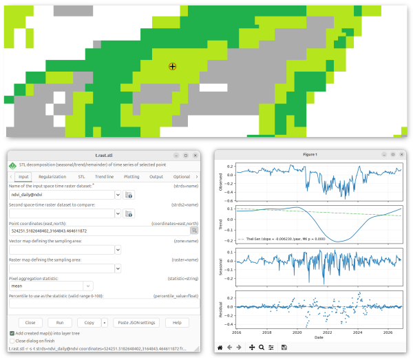
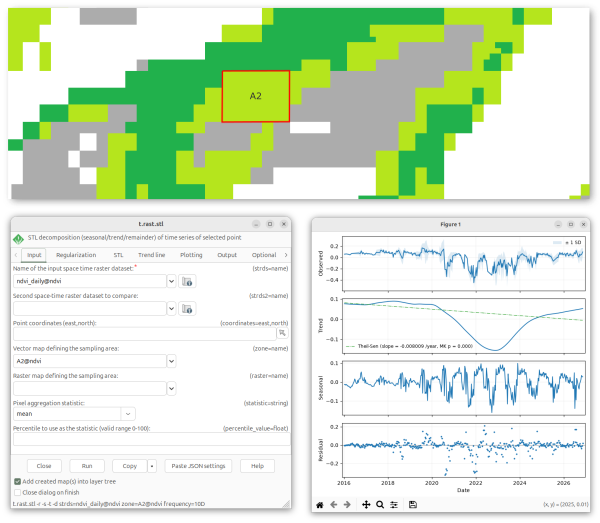
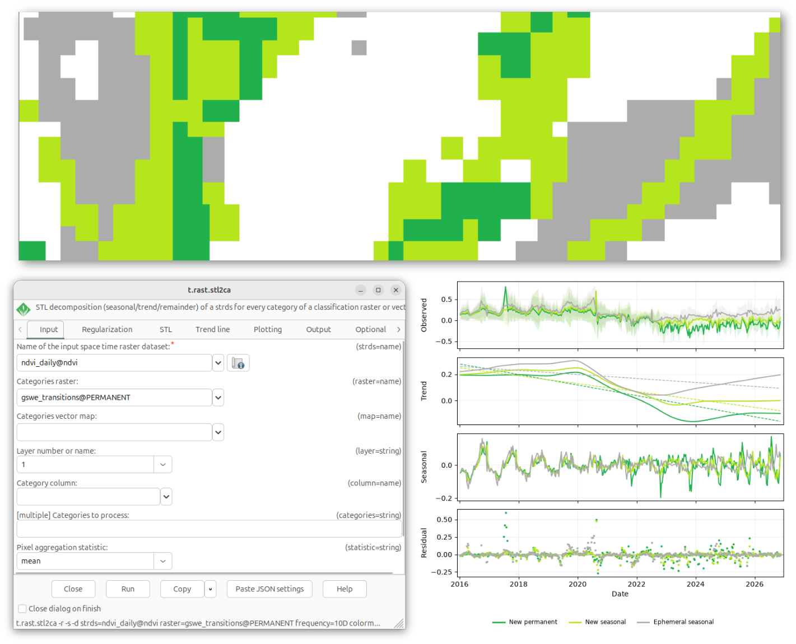
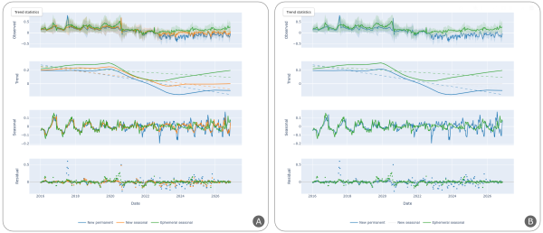

## DESCRIPTION

*t.rast.trend* included tools for STL decomposition (Seasonal- Trend
decomposition using LOESS) and trend analysis of a space-time raster dataset
(STRDS):

### t.rast.stl

The *t.rast.stl* tool decomposes and plots the time series of the values at a
single point using STL. Optionally, one or more trend regressions can be fitted
to the deseasonalized series and drawn on the trend panel, including an ordinary
least-squares (OLS) line, a robust Theil-Sen line, and/or a Generalized Additive
Model (GAM) curve, shape-constrained (monotone) by default.

Alternatively, *t.rast.stl* can compute for each time step the mean/median of
all pixels in an area defined by a vector or raster layer, and use those values
as input for the STL analysis. In the figure below, this is done for the area
A2.

### t.rast.stl2ca

*t.rast.stl2ca* extracts, for every **category** of a raster map or vector map,
the time series of a space-time raster dataset (STRDS), as the mean, median or
other statistic of the pixels in that category. It then carries out a STL
analysis on each category's series and draws every category together on one
multi-panel plot comparing the observed series, *trend*, *seasonal* and
*residual* (remainder) components. Optionally, a robust Theil-Sen trend
regression can be fitted to each category's deseasonalized series and drawn on
the trend panel.

The categories can be defined by a categorical raster layer (**raster**), or a
vector map's features grouped by an attribute column
(**map**/**layer**/**column**). This can, for example, be a land-cover raster,
or a vector of administrative units grouped by region name.

By default, the tool uses the matplotlib library to create the plots.
Alternatively, the plotly library can be used, which creates a webpage with an
interactive plot, allowing you to select one or more categories, thus making it
easier to compare trends in case there are many categories.

### Acknowledgement

This tool was developed for the
[Save the tiger! Save the Grasslands! Save the Water!](https://savethetiger.nl/)
project, funded by the Dutch Research Council (NWO) under award
<https://doi.org/10.61686/UYHYF97856>.

## Notes

Installing *t.rast.trend* installs both tools together with the shared
*trendlib* they depend on. Installing *t.rast.stl* or *t.rast.stl2ca* on its own
does not install *trendlib*, so install *t.rast.trend* first (or alongside) if
installing either tool individually.

## SEE ALSO

*[t.rast.stl](t.rast.stl.md)*, *[t.rast.stl2ca](t.rast.stl2ca.md)*

## AUTHOR

[Paulo van Breugel](https://ecodiv.earth),
[Innovative Biomonitoring](https://www.has.nl/en/research/professorships/innovative-bio-monitoring-professorship/)
and
[Climate-robust Landscapes](https://www.has.nl/en/research/professorships/climate-robust-landscapes-professorship/)
research groups at the [HAS green academy](https://has.nl)
