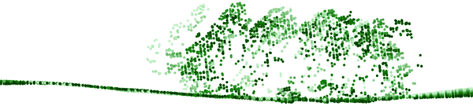
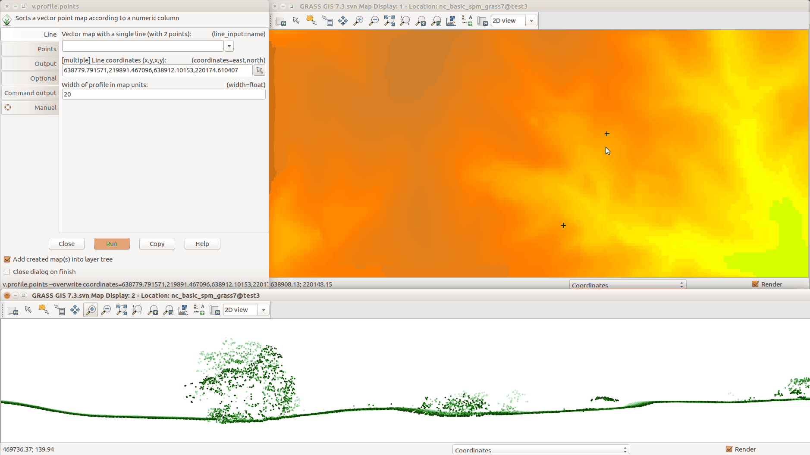

## DESCRIPTION

*v.profile.points* creates profile (transect) from vector point map or a
lidar point cloud stored in a LAS file. A LAS (or LAZ) file is imported
with *v.in.pdal* limited to the bounding box of the profile area and then
clipped to the profile area. When *v.in.pdal* is not available,
*v.in.lidar* is used instead.

  
*Figure: Profile (transect) of a lidar point cloud, closer points are
darker, further points are lighter*

### Workflow in GUI

First Map Display should contain some base layers such as point density
raster or digital elevation model. First Map Display should contain the
resulting profile or profiles. Optionally a grid overlay can be added.
The "Zoom to selected map layers" button in the Map Display toolbar
should be used to zoom to the newly created profile. The **coordinates**
option in the Line tab can be activated, deactivated, or cleared during
the work as need.

[](v_profile_points_workspace.png)  
*Figure: Creating the profile in GUI: running module from the top left
window; selecting line points in the Map Display in the top right;
resulting profile in the bottom.*

## NOTES

ASCII files such as CSV can be profiled after import and raster maps can
be profiles after conversion to vector points. It is advantageous to
limit the import or the conversion just to the area of interest to avoid
unnecessary overhead.

## EXAMPLE

```sh
v.profile.points file_input=.../points.las output=points_profile width=5 \
    coordinates=2090904,731231,2091435,731252
```

## SEE ALSO

*[v.in.lidar](v.in.lidar.md), [v.in.pdal](v.in.pdal.md),
[v.select](v.select.md), [v.transform](v.transform.md)*

## AUTHORS

Vaclav Petras, [NCSU GeoForAll
Lab](https://geospatial.ncsu.edu/geoforall/)
